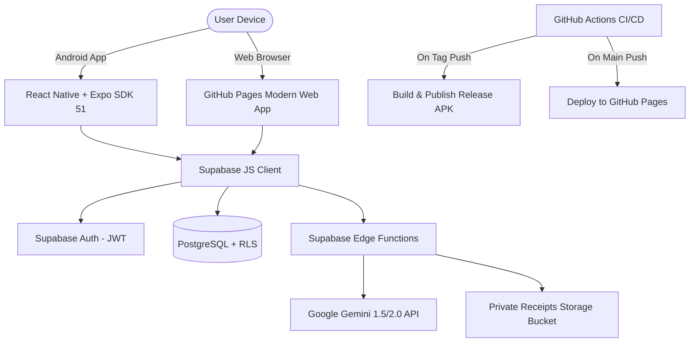

# 🪙 PennyFlow

> **Smart Spending, Zero Financial Stress.**  
> An intelligent, entertaining, and privacy-first personal expense tracker and AI financial coach for Android and Web.

[](https://github.com/Watot12345/Expense-Tracker/releases/latest)
[](https://github.com/Watot12345/Expense-Tracker/actions/workflows/release.yml)
[](https://watot12345.github.io/Expense-Tracker/)
[](#)
[](https://expo.dev)
[](https://supabase.com)
[](#)

---

## 🚀 Quick Links & Downloads

| Target | Description | Link |
| :--- | :--- | :--- |
| 📱 **Android APK** | Standalone production signed APK (`v1.0.0`) | [**📥 Download APK (v1.0.0)**](https://github.com/Watot12345/Expense-Tracker/releases/latest/download/PennyFlow-v1.0.0.apk) |
| 🌐 **Live Web Demo** | Interactive GitHub Pages experience (Instant Demo Mode) | [**🎮 Launch Web App**](https://watot12345.github.io/Expense-Tracker/) |
| 📋 **Release Notes** | Full changelog & release verification | [**View CHANGELOG.md**](CHANGELOG.md) |
| 🛠️ **Deployment Guide** | Android builds, Keystore signing, GitHub Actions | [**View RELEASE.md**](RELEASE.md) |

---

## ✨ Entertaining & Real-World Features

### 🤖 "Penny" AI Financial Coach (3 Personalities)
PennyFlow doesn't just display numbers — it coaches you with customized personality modes:
- 🧐 **Pragmatic Advisor**: Clear 50/30/20 budget allocations, burn rate warnings, and safe daily caps.
- 🔥 **Roast My Spending**: Brutally hilarious roasts about your latte addictions, food delivery splurges, and runaway subscriptions.
- 🏆 **Hype Coach**: High-octane motivational celebrations and praise whenever you stay under budget or hit savings milestones.

### 📷 Interactive Receipt Scanner & Laser OCR
- Scan receipts with your phone camera or select from curated sample receipts (Starbucks, Trader Joe's, Uber, Netflix).
- Visual neon-laser scan animation with optical character recognition.
- Automatically extracts **Merchant**, **Date**, **Total**, **Tax**, and **Itemized Sub-items**.
- Flags recurring charges and offers one-click addition to subscriptions.

### 🛡️ Daily Safe-to-Spend Dial
- Dynamically calculates:
  $$\text{Daily Safe Spend} = \frac{\text{Monthly Budget} - \text{Current Expenses}}{\text{Days Remaining in Month}}$$
- Instant visual reassurance so you always know how much you can spend today without feeling guilty.

### 🧟 Zombie Subscription Killer
- Scans all recurring subscriptions (Netflix, Spotify, Gym, Cloud Storage).
- Detects sneaky price-creeps and unused memberships.
- **1-Click Cancellation Assistant**: Generates pre-written, formal cancellation emails copied to your clipboard with a single click.

### 🎮 Gamification & Audio Synthesis
- Built-in Web Audio API sound generator for satisfying tactile coin clinks, cash register dings, and victory fanfare.
- Confetti cannon bursts when hitting savings goals or staying disciplined.
- Toggle sound on or off with one tap.

### 💼 Real-World Productivity Tools
- **Export to CSV**: Instant standard spreadsheet export for Excel, Google Sheets, or tax preparation.
- **JSON Backup**: One-click complete financial backup and offline restore.
- **Multi-Currency Support**: USD ($), EUR (€), GBP (£), PHP (₱), INR (₹), JPY (¥), CAD (C$), AUD (A$).
- **Dual Mode**: Try in **Interactive Demo Mode** (zero setup, preloaded realistic finances) or **Supabase Cloud Sync Mode** (encrypted cloud database with Row-Level Security).

---

## 🛠️ Architecture & Tech Stack



- **Frontend (Mobile)**: React Native, Expo SDK 51, TypeScript, NativeWind (Tailwind CSS), Reanimated, Lucide Icons.
- **Frontend (Web / GitHub Pages)**: Vanilla Modern JS, Tailwind CDN, Chart.js 4, Canvas Confetti, Web Audio API Synthesizer.
- **Backend**: Supabase PostgreSQL, Row-Level Security (RLS), Edge Functions (Deno).
- **CI/CD Pipeline**:
  - `.github/workflows/release.yml`: Automated Android APK compilation, SHA256 checksum generation, and GitHub Release publication.
  - `.github/workflows/deploy-pages.yml`: Automated GitHub Pages continuous deployment.

---

## 📱 How to Install the Android APK

1. On your Android phone, download the latest APK:  
   👉 [**Download PennyFlow-v1.0.0.apk**](https://github.com/Watot12345/Expense-Tracker/releases/latest/download/PennyFlow-v1.0.0.apk)
2. Tap the notification or open your **Downloads** folder.
3. If prompted by Android, tap **Settings** and toggle **"Allow from this source"**.
4. Tap **Install** and start tracking!

---

## 💻 Local Development Setup

### Prerequisites
- Node.js 18+ (Node 20 recommended)
- npm or yarn
- Expo CLI (`npx expo`)
- JDK 17 (for native Android builds)

### 1. Clone the repository
```bash
git clone https://github.com/Watot12345/Expense-Tracker.git
cd Expense-Tracker
```

### 2. Install dependencies
```bash
npm install
```

### 3. Environment Variables
Copy `.env.example` to `.env`:
```bash
cp .env.example .env
```
Fill in your Supabase project URL and anon public key.

### 4. Run Locally
- **Start Expo Mobile App**:
  ```bash
  npm start
  ```
- **Run on Android Emulator / Physical Device**:
  ```bash
  npm run android
  ```
- **Run Web Version**:
  ```bash
  npm run web
  ```

---

## 🤖 Continuous Integration & Releases

### Triggering an Automated GitHub Release
Simply create and push a semantic version tag:
```bash
git tag -a v1.0.0 -m "Release v1.0.0"
git push origin v1.0.0
```
GitHub Actions will automatically:
1. Spin up an Ubuntu runner with JDK 17 & Android SDK.
2. Run Expo prebuild and `./gradlew assembleRelease`.
3. Package the release APK as `PennyFlow-v1.0.0.apk`.
4. Calculate cryptographic SHA-256 integrity checksums.
5. Create an official GitHub Release with release notes and downloadable assets.

For more details, see [**RELEASE.md**](RELEASE.md).

---

## 📄 License

This project is licensed under the [MIT License](LICENSE).
