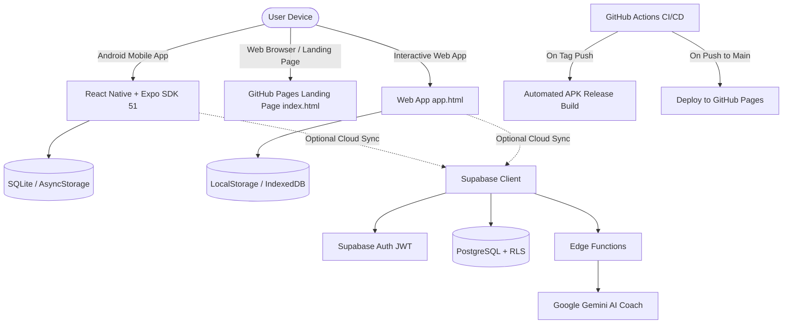

# 🪙 PennyFlow — Smart Spending & AI Financial Coach

> **Master Your Money With Intelligent Spending, Laser OCR & AI Coaching.**  
> An open-source, privacy-first personal expense tracker and AI financial coach designed for Android and the Web.

[](https://github.com/Watot12345/Expense-Tracker/releases/latest)
[](https://watot12345.github.io/Expense-Tracker/)
[](https://watot12345.github.io/Expense-Tracker/app.html)
[](LICENSE)
[](#)
[](https://expo.dev)
[](https://supabase.com)

---

## 🌐 Live Links & Official Downloads

| Target | Description | URL / Link |
| :--- | :--- | :--- |
| 🚀 **Official Landing Page** | Project showcase, bilingual guide, FAQ & developer info | [**Visit Landing Page**](https://watot12345.github.io/Expense-Tracker/) |
| 📱 **Android APK (`v1.0.0`)** | Standalone production signed APK for Android 8.0+ | [**📥 Download PennyFlow APK**](https://github.com/Watot12345/Expense-Tracker/releases/latest/download/PennyFlow-v1.0.0.apk) |
| 🎮 **Interactive Web App** | Try the full web app directly in your desktop or mobile browser | [**Launch Web App (Demo)**](https://watot12345.github.io/Expense-Tracker/app.html) |
| 📦 **GitHub Releases** | Changelog, APK assets, and release archives | [**View Releases**](https://github.com/Watot12345/Expense-Tracker/releases) |
| 📄 **MIT License** | Open-source permissive license terms | [**View LICENSE**](LICENSE) |

---

## ✨ Key Features

### 🛡️ 1. Daily Safe-to-Spend Dial
Never guess whether you can afford lunch today. PennyFlow recalculates your daily safe spending ceiling every morning:
$$\text{Daily Safe Spend} = \frac{\text{Monthly Budget} - \text{Expenses to Date}}{\text{Days Remaining in Cycle}}$$
- Instantly alerts you if you are pacing ahead of or behind your budget.
- Adjusts automatically as new expenses or recurring subscriptions roll in.

### 🤖 2. "Penny" AI Financial Coach (3 Personalities)
Penny isn't just another dry calculator; it coaches and challenges your money habits:
- 🧐 **Pragmatic Advisor**: Practical 50/30/20 budgeting splits, cashflow forecasting, and safe spending buffers.
- 🔥 **Roast My Spending**: Brutally hilarious roasts about your 3rd iced coffee of the day and impulsive delivery orders.
- 🏆 **Hype Coach**: High-energy positive reinforcement and motivational celebrations when you stay disciplined.

### 🧾 3. Laser Receipt OCR Scanner
- Point your camera at any store, restaurant, or supermarket receipt.
- High-precision optical character recognition extracts **Merchant**, **Date**, **Total**, and itemized charges with zero manual typing.
- Built-in visual laser scan beam and tactile feedback.

### 🧟 4. Zombie Subscription Killer
- Scans recurring gym passes, streaming apps, and cloud subscriptions.
- Detects sneaky price hikes and forgotten billing cycles.
- **1-Click Cancellation Assistant**: Generates formal, pre-written cancellation emails and copies them straight to your clipboard.

### 🎮 5. Tactile Audio FX & Gamification
- Synthesized audio via Web Audio API: satisfying coin clinks, cash register dings, and victory fanfare.
- Confetti cannon bursts when hitting savings milestones.
- Sound FX can be toggled on or off with a single tap.

### 📊 6. Multi-Currency & Frictionless Export
- Full support for Philippine Peso (₱), US Dollar ($), Euro (€), British Pound (£), Japanese Yen (¥), and more.
- One-click standard **CSV spreadsheet export** for Excel, Google Sheets, or tax filing.
- One-click **JSON database backup and restore** for 100% offline security.

---

## 📱 How to Install on Android

1. Download the latest APK file directly from GitHub Releases:  
   👉 [**Download PennyFlow-v1.0.0.apk**](https://github.com/Watot12345/Expense-Tracker/releases/latest/download/PennyFlow-v1.0.0.apk)
2. Swipe down your notification bar or navigate to your phone's **Downloads** folder, then tap `PennyFlow-v1.0.0.apk`.
3. If Android shows a prompt stating *"For your security, your phone is not allowed to install unknown apps"*, tap **Settings** and toggle **"Allow from this source"**.
4. Tap **Install** and open PennyFlow!

---

## 🏛️ System Architecture



---

## 💻 Local Development Setup

### Prerequisites
- Node.js 18+ (Node.js 20 LTS recommended)
- npm or yarn
- Expo CLI (`npx expo`)
- OpenJDK 17 (only required for local native Android APK compilation)

### 1. Clone the repository
```bash
git clone https://github.com/Watot12345/Expense-Tracker.git
cd Expense-Tracker
```

### 2. Install dependencies
```bash
npm install
```

### 3. Configure environment variables
Copy the example environment configuration:
```bash
cp .env.example .env
```
Provide your optional Supabase credentials if enabling cloud sync.

### 4. Run development servers
- **Start Expo Mobile App**:
  ```bash
  npm start
  ```
- **Run on Android Emulator / Physical Device**:
  ```bash
  npm run android
  ```
- **Run Web Version**:
  ```bash
  npm run web
  ```
- **Preview Static Landing Page Locally**:
  ```bash
  npx serve .
  ```
  Open `http://localhost:3000` to view the official landing page, or `http://localhost:3000/app.html` for the web app.

---

## 👨‍💻 Meet the Developer

Developed with ❤️ by **Joshua Sierra** ([@Watot12345](https://github.com/Watot12345))

- 🌐 **Portfolio**: [joshuasierra.vercel.app](https://joshuasierra.vercel.app)
- 🐙 **GitHub**: [github.com/Watot12345](https://github.com/Watot12345)
- 📘 **Facebook**: [Joshua Sierra on Facebook](https://www.facebook.com/profile.php?id=61590879324960)
- 📷 **Instagram**: [@jus_wa143](https://www.instagram.com/jus_wa143?vrfl=cmd6bzlkeDh6eGhi)
- 🎵 **TikTok**: [@joshuasierra143](https://www.tiktok.com/@joshuasierra143)

Also check out [**SariMe**](https://watot12345.github.io/sarisariApp/) — the free offline POS and utang ledger app for Filipino sari-sari stores.

---

## 📄 License

This project is open-source and released under the terms of the [MIT License](LICENSE).
Feel free to use, fork, study, and contribute!
